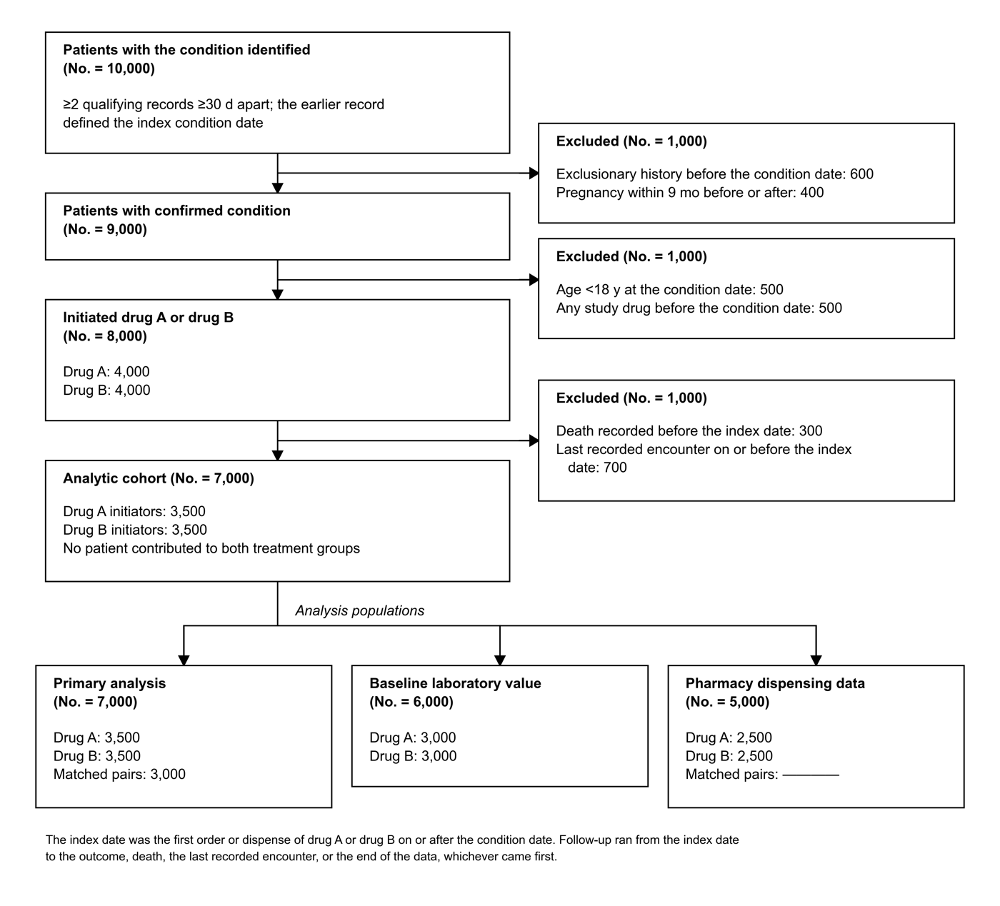

# flow-diagram-yw — a Claude Code skill for CONSORT / STROBE flow diagrams

A [Claude Code](https://claude.com/claude-code) skill that builds publication-ready study flow
diagrams (CONSORT for trials, STROBE for observational and target-trial-emulation cohorts) in
JAMA figure format.



*Example output. All counts are made up.*

## What it does

- Draws the figure in matplotlib and exports **PDF, SVG and 600-dpi PNG**.
- Follows JAMA figure rules: Arial/Helvetica ≥6 pt, embedded TrueType fonts, black rules, no
  colour or shading, thousands commas, "No." rather than "n".
- Keeps every count in **one dict**. Missing counts (`None`) print as a visible em-dash rule, so a
  draft can circulate with its gaps flagged.
- **Checks the arithmetic**: every derived count is verified, e.g. screened − excluded = enrolled.
- Wraps the figure in a one-page **Word file** with title and legend, for co-authors.

## Install

```bash
git clone https://github.com/yw3774/Skill-of-consort-diagram.git ~/.claude/skills/flow-diagram-yw
```

Requires Python 3 with `matplotlib`, `python-docx` and `Pillow`:

```bash
pip install matplotlib python-docx pillow
```

## Use

In Claude Code, ask for it in plain words, e.g. *"make a CONSORT diagram for my cohort"* or
*"update the counts in Figure 1"*, or type `/flow-diagram-yw`.

To use it without Claude, copy `examples/example_cohort.py`, edit the `N` dict and the `step(...)`
calls, and run it:

```bash
python3 example_cohort.py
python3 ~/.claude/skills/flow-diagram-yw/scripts/make_docx.py consort_diagram.png consort_diagram.docx --title "Figure 1. Flow of Patients Through the Study"
```

## Files

| Path | Purpose |
| --- | --- |
| `SKILL.md` | Instructions Claude follows: workflow, JAMA conventions, content lessons |
| `scripts/flowlib.py` | Drawing engine (`Flow`: `step`, `branches`, `footnote`, `save`, `chk`) |
| `scripts/make_docx.py` | Word figure sheet with title and legend |
| `examples/example_cohort.py` | Worked example with made-up counts |
